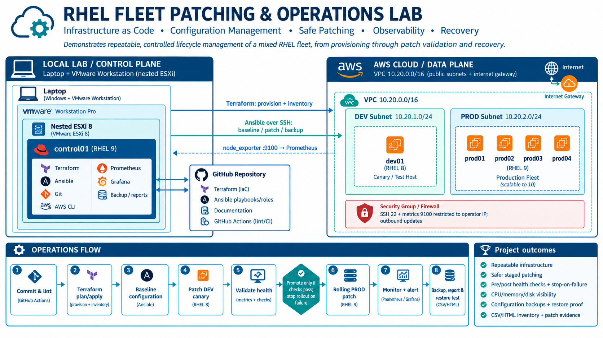
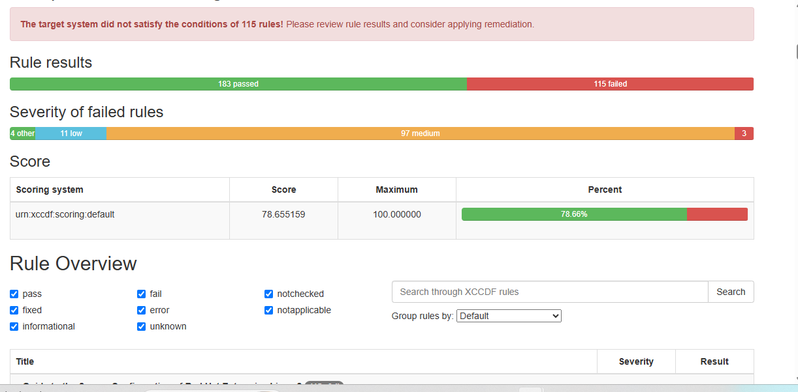
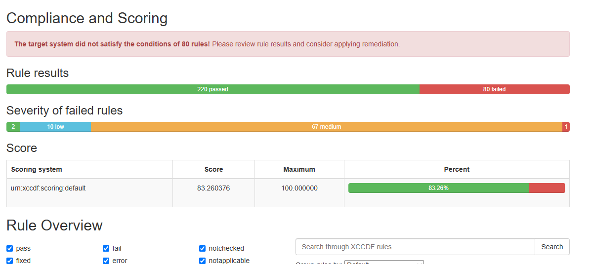
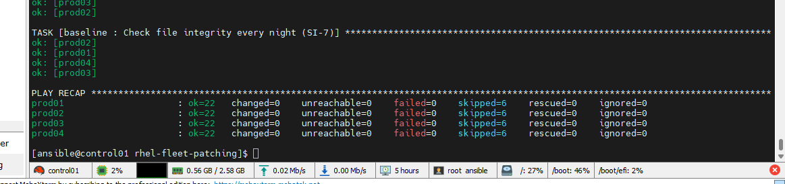
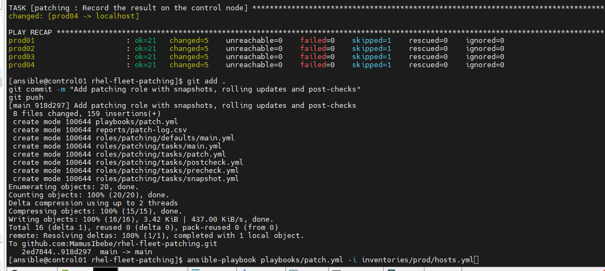
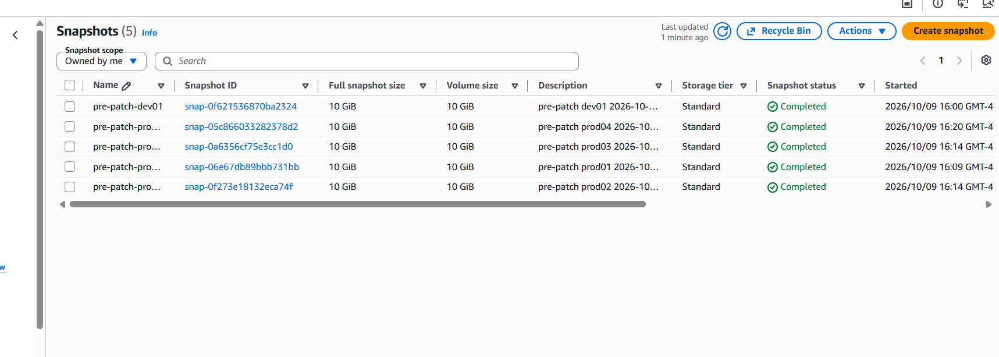
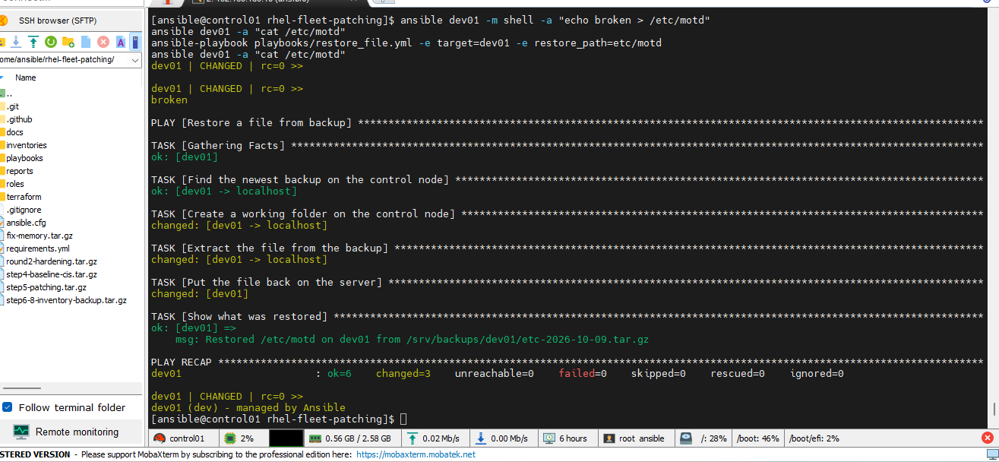
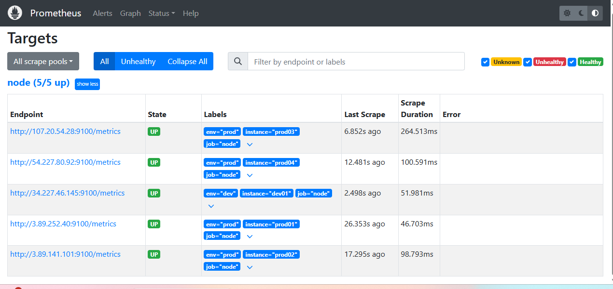
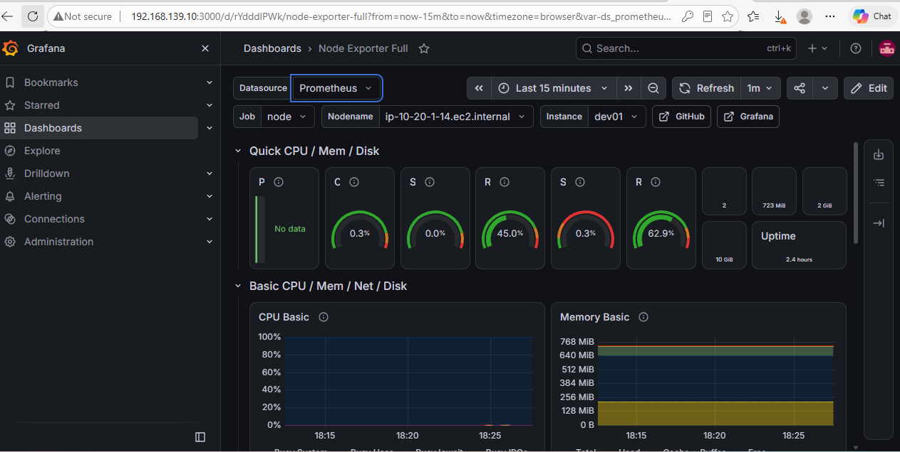

# RHEL fleet patching and compliance lab

An automated patching, hardening and compliance pipeline for a small fleet of Red Hat
Enterprise Linux servers. One control node, running on VMware ESXi, builds the fleet on
AWS with Terraform and manages it with Ansible: it applies a CIS-aligned baseline,
measures it with OpenSCAP, patches dev before prod with a rollback snapshot, monitors
every server, backs up configuration and reports inventory.

I built this to practise the day-to-day work of a Linux and VMware platform engineer:
keeping servers consistent, patched, observable and documented.

## Architecture



| Layer | What is used |
| --- | --- |
| Hypervisor | VMware ESXi 8.0.3 (free edition), nested in VMware Workstation |
| Control node | RHEL 9 VM on ESXi: Terraform, ansible-core 2.14, AWS CLI |
| Fleet | AWS EC2 `t3.micro`: 1 dev server on RHEL 8, 4 prod servers on RHEL 9 (1 to 10 by variable) |
| Network | Dedicated VPC, dev and prod subnets, security group open only to my IP |
| Compliance | CIS Benchmark Level 1 Server, measured with OpenSCAP |
| Monitoring | node_exporter, Prometheus with alert rules, Grafana dashboards |

## What it does

| Capability | How | Where |
| --- | --- | --- |
| Build the fleet from code | Terraform creates the VPC, subnets, firewall and servers, and writes the Ansible inventory | `terraform/main.tf` |
| Standard secure configuration | CIS-aligned baseline: SSH hardening, firewall, SELinux, audit, kernel settings, password policy, AIDE | `roles/baseline` |
| Measure compliance | OpenSCAP scan against `cis_server_l1`, score logged, HTML report collected | `roles/compliance` |
| Security patching | Pre-checks, AWS snapshot, security updates, reboot only if needed, post-checks, result logged | `roles/patching` |
| Controlled rollout | Dev first; in prod one canary server, then batches; stops on first failure | `playbooks/patch.yml` |
| Monitoring and alerting | Metrics from every server, alerts for server down, disk and memory, fleet dashboard | `roles/node_exporter`, `roles/prometheus_server` |
| Backup and restore | `/etc` archived to the control node; single-file restore playbook, tested | `roles/backup`, `playbooks/restore_file.yml` |
| Inventory | CSV and HTML report of every server: IPs, OS, kernel, size, last patch date | `playbooks/inventory_report.yml` |
| Change control | Example change record, failure and restore runbooks, control mapping | `docs/` |
| Quality checks | yamllint, ansible-lint and `terraform fmt` on every push | `.github/workflows/lint.yml` |

## Results

### Compliance: before and after
Measured with OpenSCAP against CIS Level 1 Server on 9 October 2026.

| Server | Stage | Passed | Failed | Score |
| --- | --- | --- | --- | --- |
| dev01 (RHEL 8.10) | Stock AWS image | 183 | 115 | 78.66% |
| dev01 (RHEL 8.10) | After baseline, round one | 207 | 93 | 82.07% |
| dev01 (RHEL 8.10) | After baseline, round two | 220 | 80 | 83.26% |
| prod01 to prod04 (RHEL 9.6) | Stock AWS image | 154 | 106 | 76.42% |
| prod01 to prod04 (RHEL 9.6) | After baseline | 192 | 70 | 80.02% |

High-severity findings on dev01 fell from 3 to 1. The score is not 100% on purpose:
the remaining rules and the reason each was left are listed in
[docs/compliance-mapping.md](docs/compliance-mapping.md).

### Patching
All five servers were patched in one controlled rollout, each with a snapshot taken
immediately beforehand.

| Order | Server | Started | Notes |
| --- | --- | --- | --- |
| 1 | dev01 | 16:00 | Kernel 4.18.0-553.158.1 to 4.18.0-553.172.1, rebooted, healthy |
| 2 | prod01 | 16:09 | Canary, patched alone |
| 3 | prod02, prod03 | 16:14 | First batch |
| 4 | prod04 | 16:20 | Final batch |

Every run is recorded in [reports/patch-log.csv](reports/patch-log.csv) with the kernel
before and after, whether a reboot happened, and the snapshot ID.

### Other checks
- **Idempotence:** a second run of the baseline on prod reported `changed=0` on every server.
- **Restore:** `/etc/motd` on dev01 was deliberately overwritten and restored from backup by playbook.
- **Monitoring:** 5 of 5 servers up in Prometheus; stopping the agent on dev01 was detected and alerted.

## Screenshots

| | |
| --- | --- |
| Compliance before  | Compliance after  |
| Baseline is idempotent  | Prod patch run  |
| Pre-patch snapshots in AWS  | Restore test  |
| Prometheus targets  | Grafana fleet status  |

## Repository layout

```
terraform/main.tf           VPC, subnets, security group, EC2 servers, generated inventory
playbooks/site.yml          apply the baseline
playbooks/compliance_scan.yml   OpenSCAP scan and score
playbooks/patch.yml         rolling security patching
playbooks/monitoring.yml    node_exporter, Prometheus, Grafana
playbooks/backup.yml        archive /etc to the control node
playbooks/restore_file.yml  restore one file from backup
playbooks/inventory_report.yml  CSV and HTML inventory
roles/                      swap, baseline, compliance, patching, node_exporter, prometheus_server, backup
docs/                       change record, runbooks, compliance mapping
reports/                    patch log, compliance log, inventory reports
```

## How to run it

Prerequisites on the control node: Terraform, ansible-core, the AWS CLI configured with
credentials, and an SSH key at `~/.ssh/id_ed25519`.

```bash
ansible-galaxy collection install -r requirements.yml

# Build the fleet (4 prod servers by default; up to 10 with -var prod_count=10)
terraform -chdir=terraform init
terraform -chdir=terraform apply

# Dev first, then prod: add -i inventories/prod/hosts.yml to each command for prod
ansible-playbook playbooks/compliance_scan.yml     # measure before
ansible-playbook playbooks/site.yml                # apply the baseline
ansible-playbook playbooks/compliance_scan.yml     # measure after
ansible-playbook playbooks/patch.yml               # patch
ansible-playbook playbooks/backup.yml
ansible-playbook playbooks/inventory_report.yml

# Monitoring covers the whole fleet, so it takes both inventories
ansible-playbook playbooks/monitoring.yml -i inventories/dev/hosts.yml -i inventories/prod/hosts.yml

# Stop the servers when not in use, or remove everything
aws ec2 stop-instances --instance-ids $(terraform -chdir=terraform output -raw instance_ids)
terraform -chdir=terraform destroy
```

The default inventory is dev, so a command reaches prod only when the prod inventory is
named explicitly.

### Demonstrating the safety stop
This run treats a service that does not exist as critical. The canary fails its
post-check and the rollout halts before any other prod server is touched:

```bash
ansible-playbook playbooks/patch.yml -i inventories/prod/hosts.yml \
  -e '{"patching_critical_services": ["sshd", "nosuchservice"]}' -e patching_ec2_snapshot=false
```

## Problems I hit and how I solved them

| Problem | Cause | Fix |
| --- | --- | --- |
| ESXi would not start on a newer laptop | Windows virtualization-based security held the CPU's virtualization extensions | Moved to a laptop where VT-x could be passed through to the nested hypervisor |
| ESXi had nowhere to store VMs | On a small boot disk ESXi 8 keeps the whole disk for its system partitions | Added a second virtual disk and created a VMFS datastore on it |
| Datastore upload failed in the browser | Host Client error on a 14 GB ISO | Copied the ISO with `scp` over SSH instead |
| `Cannot allocate memory` during package installs | `t3.micro` servers have 1 GB of RAM | Added a `swap` role that runs before every other role |
| Newest Ansible collections warned or failed | RHEL 9 ships ansible-core 2.14; newer collections need a later version | Wrote small roles of my own for monitoring and used the AWS CLI for snapshots |
| Compliance report was overwritten by the next scan | Report was named by date only | Named reports by date and time |

## Lab versus production

| In this lab | In production |
| --- | --- |
| Nested ESXi on a laptop, free licence | Physical ESXi hosts managed by vCenter, with HA and vMotion |
| Control node on a laptop | Ansible Automation Platform or AWX with scheduling, RBAC and audit trail |
| Long-lived AWS access key | Short-lived role credentials; secrets in a vault |
| Updates straight from Red Hat's cloud repositories | Red Hat Satellite with content views promoted from dev to prod |
| Servers reached on public IPs restricted to one address | Private subnets reached through a VPN or bastion |
| Manual change record in Markdown | Change tickets in ServiceNow, created and updated by the pipeline |
| Terraform state on local disk | Remote state with locking |
| Backups of `/etc` to the control node | Enterprise backup with off-site copies and regular restore tests |
| A subset of CIS Level 1 | Full benchmark with documented, approved exceptions |

## Documentation

- [Compliance mapping to NIST SP 800-53 and CSF](docs/compliance-mapping.md)
- [Example change record](docs/change-record-example.md)
- [Runbook: a server fails during patching](docs/runbook-patch-failure.md)
- [Runbook: restore a configuration file](docs/runbook-restore.md)
